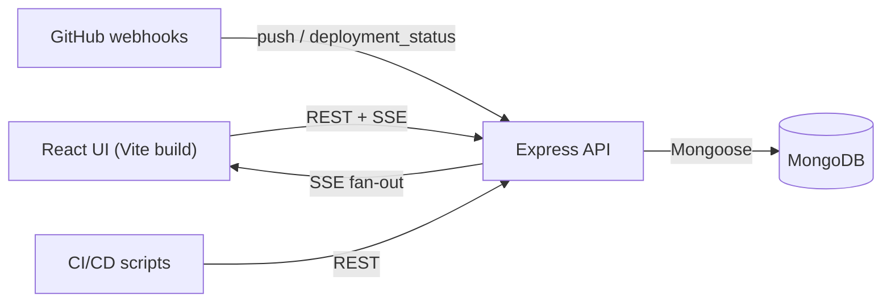
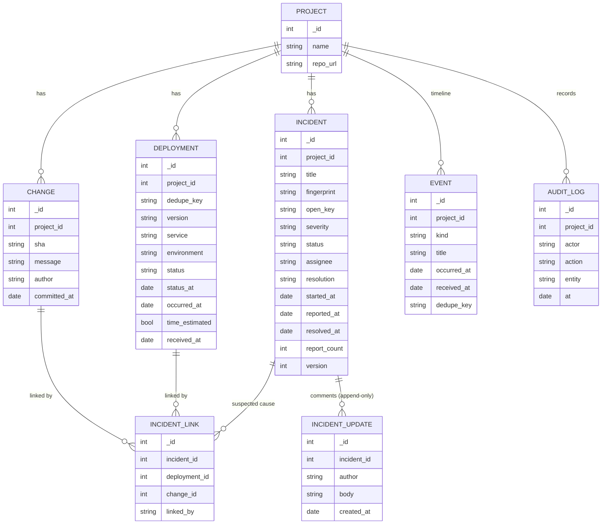
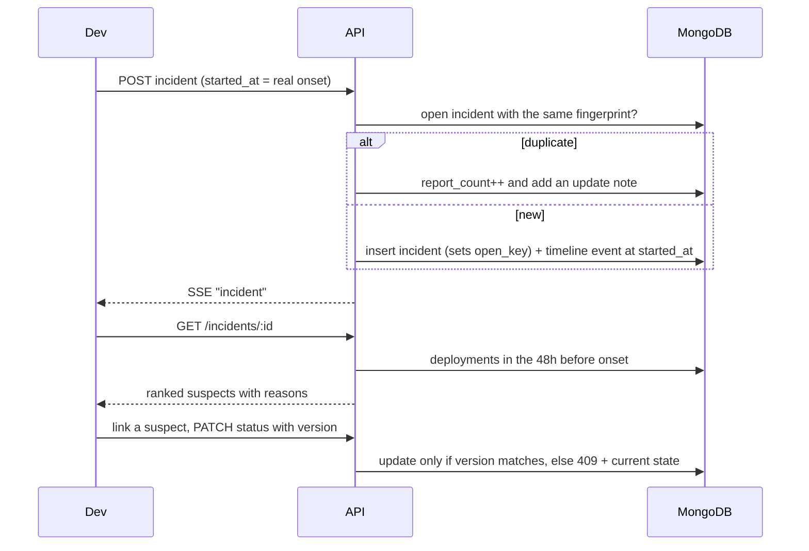

# Incident Tracker — "Who Broke the Build?"

A MERN-stack incident tracking and deployment monitoring platform. When production breaks it answers three questions: **what changed, which deployment is the likely cause, and has this happened before?**

**Stack:** MongoDB + Mongoose · Express (REST + Server-Sent Events) · React (Vite) · Node.js · Docker Compose

## Run it

### Option A: Docker (one command)
```bash
docker compose up --build        # http://localhost:3000
docker compose exec app node server/seed.js   # optional demo data
```

### Option B: locally
You need Node 18+ and a MongoDB instance (local install or a free Atlas cluster).
```bash
# 1. install and build
npm install
npm run build                    # installs client deps and builds client/dist

# 2. point at MongoDB (default is mongodb://127.0.0.1:27017/incident_tracker)
export MONGODB_URI=mongodb://127.0.0.1:27017/incident_tracker

# 3. optional demo data, then start
npm run seed
npm start                        # http://localhost:3000
```
Frontend development with hot reload (API on :3000, UI on :5173):
```bash
npm start                        # terminal 1
npm run client:dev               # terminal 2
```
Tests (need a running MongoDB; they use a throw-away database and drop it):
```bash
MONGODB_URI=mongodb://127.0.0.1:27017 npm test
```

### Roles
Demo tokens (override with `TOKENS="token:role,..."`): `admin-token`, `dev-token`, `view-token`. Pick the role in the header bar of the UI. API calls send `Authorization: Bearer <token>` and optionally `X-User: <name>` (shown as the author of updates).

| Role | Can |
|---|---|
| viewer | read everything except the audit log |
| developer | create projects, deployments, changes, incidents; edit, comment, link |
| admin | everything, plus the audit log |

## Architecture

* `server/models.js` — Mongoose schemas, indexes, sequential ids.
* `server/app.js` — all routes, auth/RBAC, SSE, webhook, correlation scoring.
* `server/index.js` — connects to MongoDB (retrying), builds indexes, listens. The server starts even while MongoDB is down; the API answers `503` with a clear message until it is up.
* `server/seed.js` — demo data. `test/api.test.js` — integration tests.
* `client/` — React app: intro page plus the tracker at `#/tracker`.

Ids are small sequential integers (a `counters` collection) instead of ObjectIds, so people can say "incident #12" during an outage.

## Database schema

Unique indexes that do the heavy lifting: `deployments(project_id, dedupe_key)`, `changes(project_id, sha)`, `events(project_id, dedupe_key)`, `incident_links(incident_id, deployment_id, change_id)`, and a sparse unique `incidents.open_key` (see below).

## Workflow


## Handling duplicate, delayed and conflicting events
| Problem | Approach |
|---|---|
| Duplicate deliveries (webhook retries, double clicks) | Deployments dedupe on `(project, dedupe_key)` (GitHub uses the deployment id), commits on `(project, sha)`, timeline events on `(project, dedupe_key)`. Re-sending is safe. |
| Duplicate incident reports | The title is normalised into a fingerprint (numbers and hashes stripped). An open incident with that fingerprint absorbs the report and bumps `report_count`. A sparse unique index on `open_key` (`<project>:<fingerprint>`, removed on resolve) means two simultaneous reports still cannot create two open incidents. |
| Late reports | The timeline sorts by `occurred_at`, not arrival. Incidents carry `started_at` (real onset) and `reported_at`; events logged more than a minute after they happened are flagged "(logged late)". |
| Incomplete deployment records | Only `version` is required. A missing time becomes the arrival time and is marked `time_estimated`. A later record with the real time replaces it, and missing fields are filled in without overwriting known data. |
| Out-of-order status changes | Each status carries `status_at`; the newest observation wins regardless of arrival order, and a status with a real timestamp outranks one recorded without a time. Merges use compare-and-set on an internal `rev`. |
| Simultaneous edits | Incident fields use optimistic locking: `PATCH` must send `version`. A stale write gets `409` plus the current state, and the UI reloads and says so. Comments and links are append-only, so contributors never overwrite each other. |
| Reopening | Reopening clears `resolved_at` (keeps MTTR honest) and is refused with `409` if an identical failure is already open. |

## Suspect deployment scoring
For an incident, deployments from 48 h before to 5 min after `started_at` are scored on recency (exponential decay, 6 h scale), same service, production environment, failed/rolled-back status, and whether that service was linked to earlier incidents with the same fingerprint. Estimated deploy times are penalised. Each suspect returns its reasons, and a person confirms by linking it. It is a ranking heuristic, not proof.

## API
All under `/api`; role needed in brackets.
- `GET /health` (public)
- `GET /projects` [viewer] · `POST /projects` [developer]
- `GET|POST /projects/:id/deployments` · `/changes` · `/incidents` [viewer / developer]
- `GET /incidents/:id` — incident, updates, links, ranked suspects [viewer]
- `PATCH /incidents/:id` (needs `version`) · `POST /incidents/:id/updates` · `POST /incidents/:id/links` [developer]
- `GET /projects/:id/timeline` · `/dashboard` [viewer] · `/audit` [admin] · `/stream` (SSE; `?token=` since EventSource cannot set headers)
- `POST /webhooks/github/:projectId` — handles `push` and `deployment_status`; verified with HMAC when `GITHUB_WEBHOOK_SECRET` is set (set it in production, otherwise anyone can post)

```bash
curl -H "Authorization: Bearer dev-token" -H "Content-Type: application/json" \
  -d '{"version":"v2.4.1","service":"api","status":"succeeded"}' \
  localhost:3000/api/projects/1/deployments
```

## Frontend
`client/` is a Vite + React app. The intro page (hero, pinned scroll story, feature grid) leads to the tracker at `#/tracker`: a branched menu that opens each panel (dashboard, report, deployment, incidents, detail, timeline) in a glass card over a WebGL background. React Bits components live in `client/src/components/`. Dependencies are pinned.

## Bonus items covered
GitHub webhooks · real-time updates (SSE) · role-based access · deduplication · audit log · deployment-to-incident correlation · Docker.

## Not included
Real user accounts (tokens are a demo scheme), per-project membership, pagination beyond fixed limits, and a hosted deployment (the Docker image runs on Render, Railway or Fly.io with MongoDB Atlas).

## Troubleshooting
- **"Cannot reach the database"** in the UI: MongoDB isn't running or `MONGODB_URI` is wrong. The server keeps retrying and logs each attempt.
- **Blank page at `/`**: the client isn't built. Run `npm run build`, or use `npm run client:dev` and open :5173.
